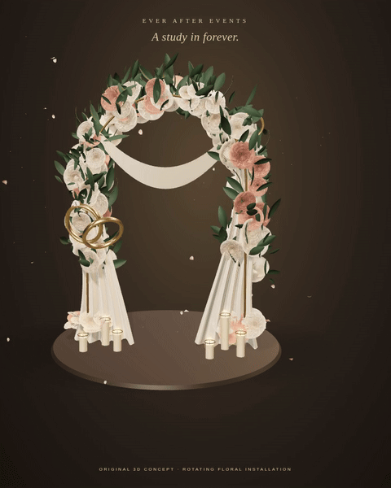

# Revised hero — first moving concept

The animation below shows the original wedding installation turning through all sides. It is a **concept for reviewing the revised visual direction**, not a claim that the final photorealistic art target has been reached. The user's reference screenshots are not used in this scene.

[Open the higher-quality MP4](Revised-Hero-Concept.mp4) · [Open the standalone HTML file](Ever-After-Events.html)

The short turntable is accelerated for review. The website turns the installation more slowly and animates the jewellery, fabric and petals independently. The turntable uses the scene's studio shadow settings; the website reduces rendering cost on mobile devices and software-rendered WebGL.

## Open the interactive website on Windows

1. Select this branch, click **Code → Download ZIP**, and choose **Extract All** in Windows.
2. In the extracted folder, open `preview`.
3. Right-click `Ever-After-Events.html` → **Open with → Chrome or Edge**.

No installation is required for that HTML file. The gallery, navigation and inquiry download are included. Email delivery is not connected.

`Walkthrough.mp4` is the earlier website revision, retained for comparison. The new concept is `Revised-Hero-Concept.mp4`.

The editable scene code is in `src/CinematicScene.js`; an original geometry export is in `design/original-floral-installation.glb`.
